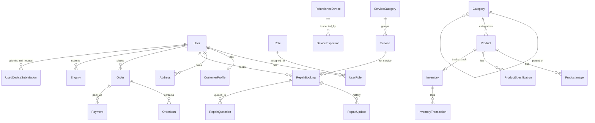

# Kiran's Infotech — Database Design

## 1. Overview & Invariants

The database is a normalized relational schema managed via Prisma ORM (`apps/api/prisma/schema.prisma`).

### Core Data Invariants
1. **Financial Precision:** All monetary columns (`costPrice`, `sellingPrice`, `acquisitionCost`, `subtotal`, `taxAmount`, `discountAmount`, `totalAmount`, `unitPrice`, `labourCost`) use fixed-point `Decimal(10, 2)` stored in INR (`₹`).
2. **Order Price Snapshots:** `OrderItem` stores immutable snapshots (`productName`, `productSku`, `unitPrice`, `lineTotal`) at the moment of order creation so later catalogue edits never corrupt historical orders.
3. **Transactional Inventory & Movement Ledger:** Every stock change updates `Inventory` inside a database transaction and appends an immutable `InventoryTransaction` record (`RESTOCK`, `SALE_ORDER`, `ORDER_CANCELLED`, `MANUAL_ADJUSTMENT`, `DAMAGED_WRITEOFF`).
4. **Single-Sale Guarantee for Refurbished Devices:** A `RefurbishedDevice` can only be purchased when `status == PUBLISHED`; purchasing atomically transitions it to `SOLD`.
5. **Private Cost Isolation:** `Product.costPrice`, `RefurbishedDevice.acquisitionCost`, `RefurbishedDevice.refurbishmentCost`, `RepairUpdate.internalNote`, and `Enquiry.internalNotes` are stripped by backend serialization and never returned by public or customer endpoints.
6. **Append-Only Repair History:** Every repair status transition creates a `RepairUpdate` row recording `status`, `customerVisibleMessage`, `internalNote`, `actorId`, and `createdAt`.
7. **Demo Mode Tagging:** Core operational tables include `isDemo Boolean @default(false)` so demonstration data is explicitly distinguishable from production records.

---

## 2. Entity-Relationship Diagram

---

## 3. Core Entities Summary

| Entity | Table | Primary Key | Unique Constraints & Key Indexes |
| :--- | :--- | :--- | :--- |
| `User` | `users` | `id (UUID)` | `email (unique)`, `phone (unique)` |
| `Role` | `roles` | `id (UUID)` | `name (unique: CUSTOMER, ADMIN, STAFF)` |
| `UserRole` | `user_roles` | `id (UUID)` | `@@unique([userId, roleId])` |
| `CustomerProfile` | `customer_profiles` | `id (UUID)` | `userId (unique)` |
| `Address` | `addresses` | `id (UUID)` | `@@index([userId])` |
| `Category` | `categories` | `id (UUID)` | `slug (unique)`, `@@index([parentId, active])` |
| `Product` | `products` | `id (UUID)` | `sku (unique)`, `slug (unique)`, `@@index([categoryId, status])` |
| `ProductImage` | `product_images` | `id (UUID)` | `@@index([productId, sortOrder])` |
| `ProductSpecification` | `product_specifications` | `id (UUID)` | `@@index([productId, key])` |
| `Inventory` | `inventories` | `id (UUID)` | `productId (unique)` |
| `InventoryTransaction` | `inventory_transactions` | `id (UUID)` | `@@index([inventoryId, createdAt])` |
| `RefurbishedDevice` | `refurbished_devices` | `id (UUID)` | `deviceCode (unique)`, `slug (unique)`, `serialNumber (unique)` |
| `DeviceInspection` | `device_inspections` | `id (UUID)` | `@@index([deviceId, inspectedAt])` |
| `UsedDeviceSubmission` | `used_device_submissions` | `id (UUID)` | `reference (unique)`, `@@index([customerId, status])` |
| `ServiceCategory` | `service_categories` | `id (UUID)` | `slug (unique)` |
| `Service` | `services` | `id (UUID)` | `slug (unique)`, `@@index([categoryId, active])` |
| `RepairBooking` | `repair_bookings` | `id (UUID)` | `reference (unique)`, `@@index([customerId, status])` |
| `RepairUpdate` | `repair_updates` | `id (UUID)` | `@@index([bookingId, createdAt])` |
| `RepairQuotation` | `repair_quotations` | `id (UUID)` | `quotationNumber (unique)`, `@@index([bookingId])` |
| `Order` | `orders` | `id (UUID)` | `reference (unique)`, `@@index([customerId, status])` |
| `OrderItem` | `order_items` | `id (UUID)` | `@@index([orderId])` |
| `Payment` | `payments` | `id (UUID)` | `@@index([orderId])` |
| `Enquiry` | `enquiries` | `id (UUID)` | `reference (unique)`, `@@index([customerId, status])` |
| `SiteContent` | `site_contents` | `id (UUID)` | `key (unique)` |
| `Notification` | `notifications` | `id (UUID)` | `@@index([userId, readAt])` |
| `AuditLog` | `audit_logs` | `id (UUID)` | `@@index([actorId, entityType, createdAt])` |
